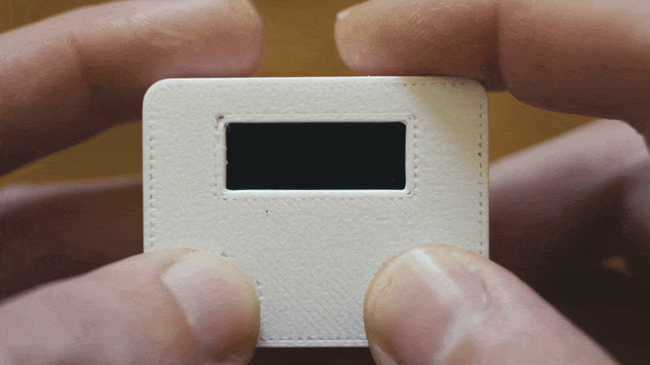
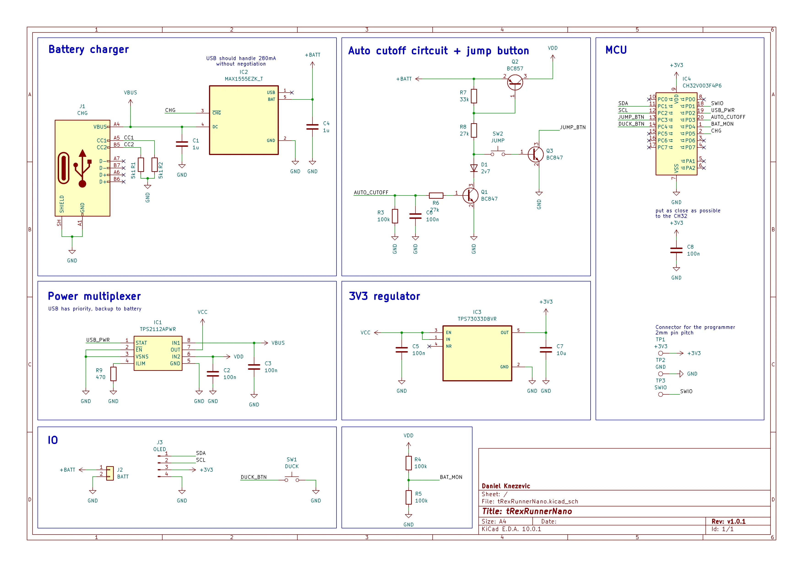
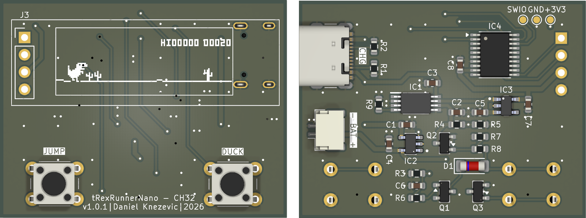
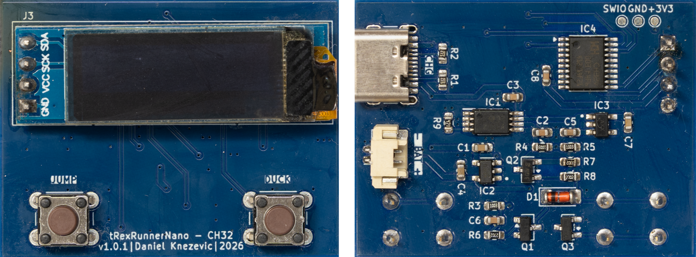
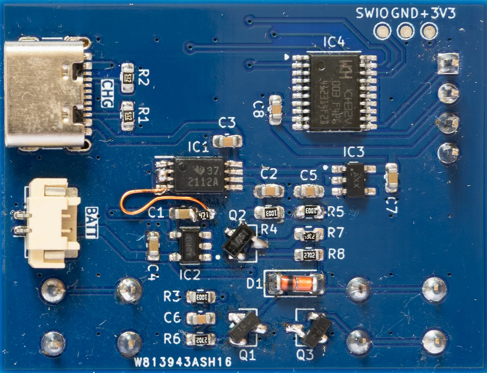

## Introduction

When a rep from PCBWay asked me if I had an idea for a new project, in absense of new ideas, I decided to bring back an old unpublished side project and give it a second life. By doing this, I got a chance to address issues identified years ago that I was not able to fix at that time.

So what it is about? Around 8 years ago, I made a keychain sized toy, running the T-Rex runner game (Google's easter egg game from the Chrome browser) featuring Atmega88 microcontroller, 128x32px OLED, two push buttons and a 100mAh LiPo battery.

This time, I have chosen to try out the WCH CH32V003 microcontroller (aka 10cent MCU) and use **ch32fun**[1] open source development environment with gcc-riscv64.

As a bonus, this can be a perfect gift for a kid.

For more details about the schematic, firmware and 3D model take a look at the [Gihub repo](https://github.com/Deni90/tRexRunnerNano).

## Sponsor time

Once again, thanks [PCBway](https://pcbway.com) for sponsoring this project and sending me PCBs and the SMD stencil for free.

## Changes

### Hardware

Schematic:

**Open image in new tab to view the full size image*

Improvements:
- Previously, flashing the firmware required soldering wires directly to the MCU. To simplify things, a dedicated connector has been added in form of 3 test points. Now, the flasher can be connected with pogo pins to quickly flash the new firmware.
- Changes on connectors:
  - Micro USB connector has been replaced with modern USB Type-C.
  - A JST 1.25mm connector has been added for the LiPo battery.
- A proper power mux (TPS2112APWR) has been added instead of using diodes and transistors.
- Tantalum capacitors are replaced with ceramic.
- Finally, the problem I couldn't solve in the original version - battery leak has been solved by:
  - moving the voltage divider after the power switch
  - using 2x100k resistors.

PCB:

Assembled PCB:

As you can see, PCBs are marked **v1.0.1**. This means I messed up something in the first version. A big lesson learned while working on this simple project is to never trust the default footprints provedided by the software - double check everything before making the order. In the first iteration, footprints for transistors had wrong pinouts.

There is no problem some creative thinking and enamel wire couldn't fix:

*Fixed v1.0.0 PCB*

### Firmware

Changes on the firmware side were straight forward:
- The ch32fun has been added as a git submodule to the repo.
- The existing C code has been ported to use the new MCU based on examples provided by the dev environment, covering GPIOs, ADC, timer and flash.
- In addition, the spaghetti code of the business logic has been refactored by using a proper state machine.

### Case

The original case has been re-made in Fusion360 with slight modifications:
- Switching push buttons from 6x6x7mm to 6x6x4.3mm simplified the desing of button caps. They are no longer hollow. Instead of wrapping around the button, they are idended to be mounted on top of the button. This resulted in more precise 3D prints with no additional cleanup/sanding required.
- The bottom lid has an updated latching mechanism. Its design is borrowed from TinyPPS' design.

3D model of the case:


3D model of the lid:


3D model of the button cap:


## References

- [ch32fun Github](https://github.com/cnlohr/ch32fun)
- [TPS2112A Datasheet](https://www.ti.com/lit/ds/symlink/tps2112a.pdf?ts=1791037807947&ref_url=https%253A%252F%252Fwww.ti.com%252Fproduct-category%252Fpower-management%252Fpower-protection-switches-controllers%252Fpower-muxes%252Fproducts.html)
- [MAX1555 Datasheet](https://www.analog.com/media/en/technical-documentation/data-sheets/MAX1551-MAX1555.pdf)
